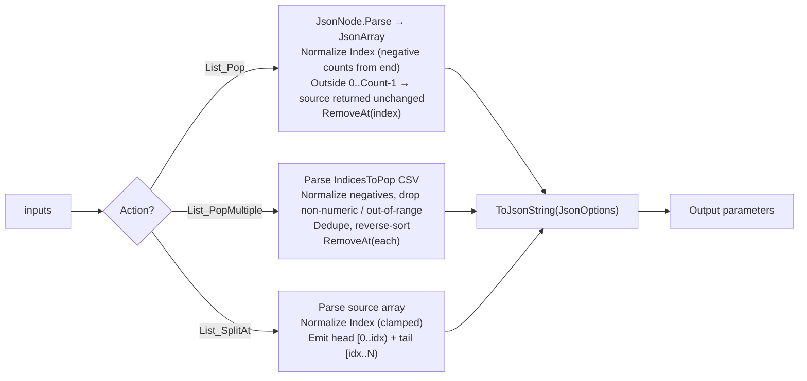
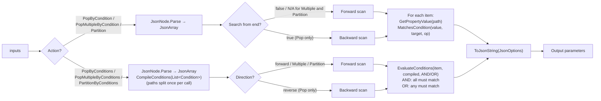
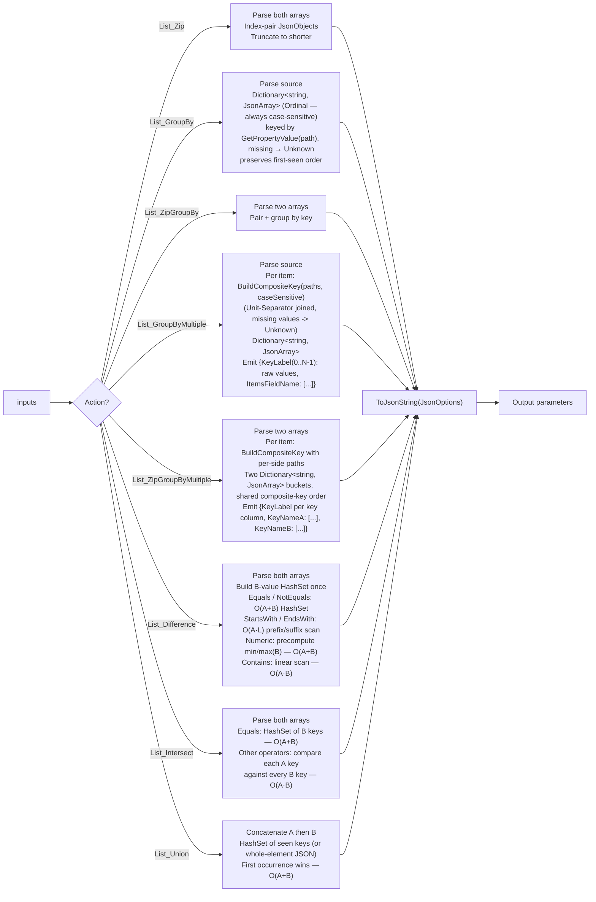
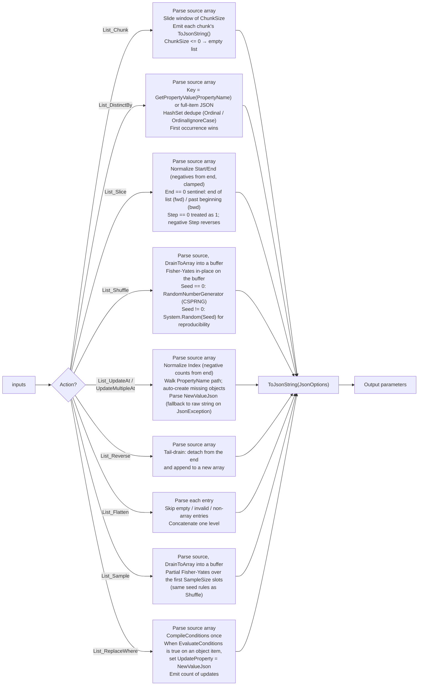
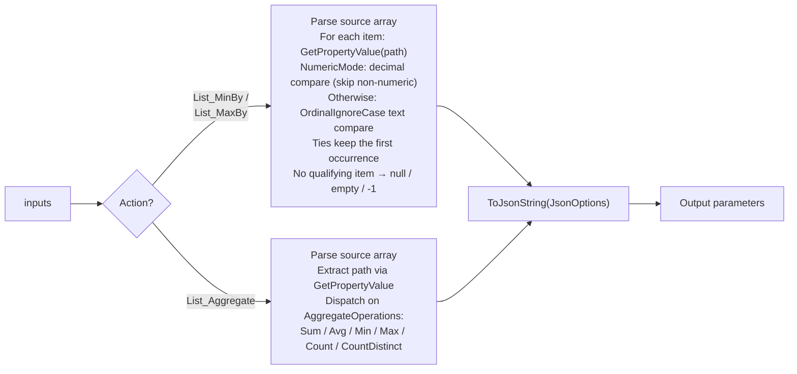
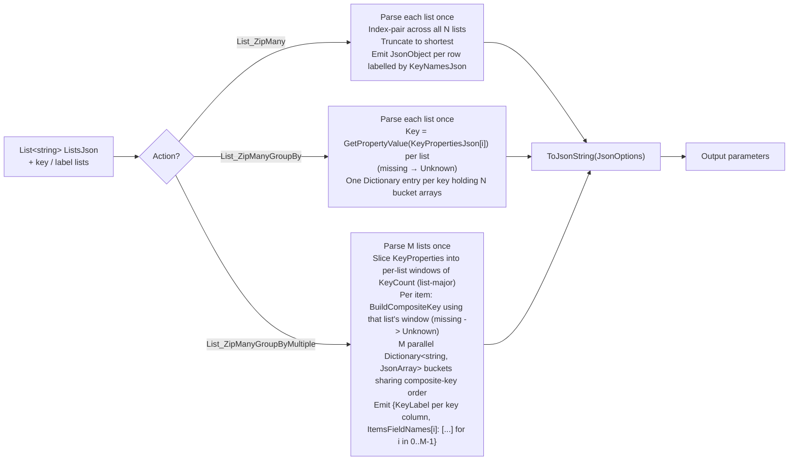
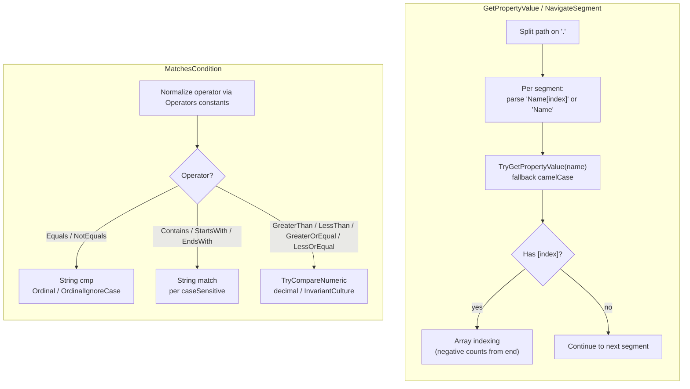

# OSListUtilsServerSide — Architecture

Structural reference for the solution, the runtime component, and the test
projects. Keep this file in sync with the code — update it whenever the
solution layout, Server Action surface, dependency set, or project structure
changes.

> **Runtime behaviour** and **Server Action signatures** live in
> [README.md](./README.md) and the [docs/platform/](./docs/platform) Forge
> copies. This document describes **structure only** — how the code is
> organised, why it is split the way it is, and where each concern lives.

---

## 1. Solution layout

```
OSListUtilsServerSide/                           ← repo root
├── ListUtils.sln                                ← solution (loads all four .csproj files)
├── ListUtils/                                   ← ODC External Library (net10.0)
├── ListUtils.Tests/                             ← ODC xUnit suite (net10.0)
├── ListUtils.O11/                               ← O11 Integration Studio extension (net48)
├── ListUtils.O11.Tests/                         ← O11 xUnit suite (net48)
├── tools/                                       ← development utilities: GenerateIcon (icon generator), LoadTest (micro-benchmark harness, see tools/LoadTest/README.md)
├── test-apps/                                   ← O11 runtime test-app evidence (manifest, dashboards, timings, screenshots)
├── xif/                                         ← generated Integration Studio XIF archive
├── xif-spec/                                    ← XIF spec/source generator
└── docs/                                        ← README/Forge copies, versioned changelogs
```

---

## 2. ODC External Library — `ListUtils/`

Target framework: **`net10.0`**. Namespace: `ListUtils`.
Primary class: `ListUtils`, implementing `IListUtils`.

### Public surface

| File | Type | Purpose |
|------|------|---------|
| [IListUtils.cs](ListUtils/IListUtils.cs) | `[OSInterface]` | Declares 33 actions: `List_Pop`, `List_PopMultiple`, `List_SplitAt`, `List_PopByCondition`, `List_PopMultipleByCondition`, `List_PopByConditions`, `List_PopMultipleByConditions`, `List_Partition`, `List_PartitionByConditions`, `List_Zip`, `List_GroupBy`, `List_ZipGroupBy`, `List_GroupByMultiple`, `List_ZipGroupByMultiple`, `List_Difference`, `List_Intersect`, `List_Union`, `List_Chunk`, `List_DistinctBy`, `List_Slice`, `List_Shuffle`, `List_UpdateAt`, `List_Reverse`, `List_Flatten`, `List_Sample`, `List_ReplaceWhere`, `List_UpdateMultipleAt`, `List_MinBy`, `List_MaxBy`, `List_Aggregate`, `List_ZipMany`, `List_ZipManyGroupBy`, `List_ZipManyGroupByMultiple` |
| [Condition.cs](ListUtils/Condition.cs) | `[OSStructure]` | `Condition` (`Path`, `Operator`, `Value`, `CaseSensitive`) used by the multi-condition actions |
| [Operators.cs](ListUtils/Operators.cs) | Static constant classes | `Operators`, `LogicalOperators`, `AggregateOperations` string constants |

The ODC interface exposes `Condition` as an `[OSStructure]` and uses typed `List<Condition>` / `List<string>` parameters where required; JSON list payloads remain `string` (`Text`). This typed ODC boundary is distinct from the O11 XIF's Integration Studio Record List representation.

### Implementation files (partial class)

`ListUtils` is a `public partial class` split across eight files by action group. The shell holds the class declaration + `IListUtils` implementation marker; each partial contributes one concern.

| File | Responsibility |
|------|---------------|
| [ListUtils.cs](ListUtils/ListUtils.cs) | Partial-class shell — declares `public partial class ListUtils : IListUtils`, no members |
| [ListUtils.Index.cs](ListUtils/ListUtils.Index.cs) | Index-based actions: `List_Pop`, `List_PopMultiple`, `List_SplitAt` |
| [ListUtils.Condition.cs](ListUtils/ListUtils.Condition.cs) | Condition-based actions: `List_PopByCondition`, `List_PopMultipleByCondition`, `List_PopByConditions`, `List_PopMultipleByConditions`, `List_Partition`, `List_PartitionByConditions` |
| [ListUtils.Relational.cs](ListUtils/ListUtils.Relational.cs) | Relational / set actions: `List_Zip`, `List_GroupBy`, `List_ZipGroupBy` (two-list cogroup), `List_GroupByMultiple` (N-key group-by), `List_ZipGroupByMultiple` (N-key two-list cogroup), `List_Difference` (including all fast-path branches), `List_Intersect`, `List_Union` |
| [ListUtils.Transform.cs](ListUtils/ListUtils.Transform.cs) | Transformation / randomization actions: `List_Chunk`, `List_DistinctBy`, `List_Slice`, `List_Shuffle`, `List_UpdateAt`, `List_Reverse`, `List_Flatten`, `List_Sample`, `List_ReplaceWhere`, `List_UpdateMultipleAt` (plus private helpers for slice normalization, CSPRNG-vs-seeded RNG shared by Shuffle and Sample, and nested-path write-back with object-only auto-creation) |
| [ListUtils.Aggregate.cs](ListUtils/ListUtils.Aggregate.cs) | Aggregations: `List_MinBy`, `List_MaxBy`, `List_Aggregate` (Sum / Avg / Min / Max / Count / CountDistinct over a property path) |
| [ListUtils.ZipMany.cs](ListUtils/ListUtils.ZipMany.cs) | Multi-list zip: `List_ZipMany`, `List_ZipManyGroupBy`, `List_ZipManyGroupByMultiple` (N-list generalisations of `List_Zip` / `List_ZipGroupBy`, plus the N-key composite variant). Accepts `List<string>` inputs so callers pass a Text List directly. |
| [ListUtils.Helpers.cs](ListUtils/ListUtils.Helpers.cs) | `GetPropertyValue` + `NavigateSegment` path walker (with a pre-split `string[]?` overload used by all per-row hot loops), `SplitPath` one-shot dotted-path splitter, `MatchesCondition` operator evaluator, `EvaluateConditions` multi-condition engine (plus a `CompiledCondition` record struct + `CompileConditions` + a pre-compiled `EvaluateConditions(JsonNode, CompiledCondition[]?, string)` overload), `TryCompareNumeric` numeric comparator, `ToCamelCase` fallback, `BuildCompositeKey` (Unit-Separator-joined N-key composite with `"Unknown"` fallback, plus a pre-compiled `BuildCompositeKey(JsonNode, string[]?[])` overload fed by `CompileKeyPaths`) and `KeyLabel` (label lookup with `"Key{i}"` default) shared by the multi-key grouping actions, `DrainToArray` (tail-drain that detaches every element from a parsed `JsonArray` so it can be re-parented without cloning), shared `JsonSerializerOptions` |

### Runtime dependencies

Declared in [ListUtils.csproj](ListUtils/ListUtils.csproj).

| Package | License | Purpose |
|---------|---------|---------|
| `OutSystems.ExternalLibraries.SDK` | OutSystems proprietary | `[OSInterface]`, `[OSAction]`, `[OSParameter]` attributes |

`System.Text.Json` is used but ships as part of the net10.0 BCL — no NuGet required. `System.Security.Cryptography.RandomNumberGenerator` (used by `List_Shuffle` when `Seed == 0`) also ships with the BCL.

### ODC processing flow

The implementation is split across six action-family partials; each partial has
its own dispatch and data-flow diagram below. All partials share the
helpers (`GetPropertyValue`, `MatchesCondition`, `EvaluateConditions`,
`DrainToArray`) described at the end.

#### `ListUtils.Index.cs` — index-based actions



#### `ListUtils.Condition.cs` — pop / partition by condition(s)



#### `ListUtils.Relational.cs` — zip / group / set operations



#### `ListUtils.Transform.cs` — chunk / distinct / slice / shuffle / update / replace / reverse / flatten / sample



#### `ListUtils.Aggregate.cs` — MinBy / MaxBy / Aggregate



#### `ListUtils.ZipMany.cs` — variadic zip / group



#### Shared helpers (used by every partial above)



Helper contracts:

- **`GetPropertyValue(node, path)`** — splits `path` on `.`, per-segment calls `NavigateSegment`. Falls back to camelCase at every step. Returns `null` if any hop fails.
- **`MatchesCondition(actual, target, op, caseSensitive)`** — case-insensitive by default. Numeric operators parse with `InvariantCulture`; non-numeric input returns `false`. Operator strings are compared against the `Operators` constants (backwards-compatible with the legacy `!=`, `>=`, `<=` symbols).
- **`EvaluateConditions(item, conditions, logicalOp)`** — AND short-circuits on first miss; OR short-circuits on first hit. Callers pass `CompileConditions(List<Condition>)` output so every `Condition.Path` is split once per call, not once per row.
- **`DrainToArray(array)`** — detaches every element from a parsed `JsonArray` (tail-first `RemoveAt`) so the nodes can be added to a new output array without `DeepClone()`.

### Build & package

`ListUtils/generate_upload_package.ps1` runs
`dotnet publish -c Release -r linux-x64 --no-self-contained` and zips the
publish folder into `ExternalLibrary.zip` at the repo root. The 90 MB ODC
upload ceiling is enforced by the script.

---

## 3. O11 Integration Studio Extension — `ListUtils.O11/`

Target framework: **`net48`**, `LangVersion=10`. Namespace: `OutSystems.NssListUtils`.

### Public surface (handwritten API and Integration Studio XIF)

| File | Type | Purpose |
|------|------|---------|
| [IssListUtils.cs](ListUtils.O11/IssListUtils.cs) | Handwritten interface | Declares 33 `Mss` methods mirroring the ODC action surface. The handwritten C# API uses `List<Condition>` and `List<string>` for list-valued parameters. |
| [Condition.cs](ListUtils.O11/Condition.cs) | Struct | O11 mirror of the ODC `Condition` Structure (`Path`, `Operator`, `Value`, `CaseSensitive`) |
| [Operators.cs](ListUtils.O11/Operators.cs) | Static constant classes | `Operators`, `LogicalOperators`, `AggregateOperations` — mirrors the ODC file |

The Integration Studio XIF represents those C# list-valued parameters as Record Lists: `Condition` has `Path`, `Operator`, `Value`, and `CaseSensitive`; `TextItem` has one Text attribute, `Value`, and is used for text-list inputs and outputs. The generated wrapper converts the XIF records to and from the handwritten API's `List<T>` types. This is an XIF boundary adaptation, not a change to the ODC or handwritten O11 C# signatures.

### Implementation files (partial class)

`CssListUtils` is a `public partial class` split in the same shape as the ODC side. Every partial mirrors its ODC counterpart line-for-line except for the platform-specific tweaks listed below.

| File | Responsibility |
|------|---------------|
| [Actions/ListUtilsActions.cs](ListUtils.O11/Actions/ListUtilsActions.cs) | Partial-class shell — declares `public partial class CssListUtils : IssListUtils`, no members |
| [Actions/ListUtilsActions.Index.cs](ListUtils.O11/Actions/ListUtilsActions.Index.cs) | `MssList_Pop`, `MssList_PopMultiple`, `MssList_SplitAt` |
| [Actions/ListUtilsActions.Condition.cs](ListUtils.O11/Actions/ListUtilsActions.Condition.cs) | `MssList_PopByCondition`, `MssList_PopMultipleByCondition`, `MssList_PopByConditions`, `MssList_PopMultipleByConditions`, `MssList_Partition`, `MssList_PartitionByConditions` |
| [Actions/ListUtilsActions.Relational.cs](ListUtils.O11/Actions/ListUtilsActions.Relational.cs) | `MssList_Zip`, `MssList_GroupBy`, `MssList_ZipGroupBy`, `MssList_GroupByMultiple`, `MssList_ZipGroupByMultiple`, `MssList_Difference` (including all fast-path branches), `MssList_Intersect`, `MssList_Union` |
| [Actions/ListUtilsActions.Transform.cs](ListUtils.O11/Actions/ListUtilsActions.Transform.cs) | `MssList_Chunk`, `MssList_DistinctBy`, `MssList_Slice`, `MssList_Shuffle`, `MssList_UpdateAt`, `MssList_Reverse`, `MssList_Flatten`, `MssList_Sample`, `MssList_ReplaceWhere`, `MssList_UpdateMultipleAt` — mirrors the ODC `ListUtils.Transform.cs` |
| [Actions/ListUtilsActions.Aggregate.cs](ListUtils.O11/Actions/ListUtilsActions.Aggregate.cs) | `MssList_MinBy`, `MssList_MaxBy`, `MssList_Aggregate` |
| [Actions/ListUtilsActions.ZipMany.cs](ListUtils.O11/Actions/ListUtilsActions.ZipMany.cs) | `MssList_ZipMany`, `MssList_ZipManyGroupBy`, `MssList_ZipManyGroupByMultiple` — `List<string>` inputs matching the ODC side |
| [Actions/ListUtilsActions.Helpers.cs](ListUtils.O11/Actions/ListUtilsActions.Helpers.cs) | Path walker (with a pre-split `string[]?` overload used by all per-row hot loops) + `SplitPath` one-shot dotted-path splitter, condition evaluator (`List<Condition>` typed input), multi-condition engine (plus a `CompiledCondition` struct + `CompileConditions` + pre-compiled `EvaluateConditions` overload), `TryCompareNumeric`, `ToCamelCase`, `BuildCompositeKey` + `KeyLabel` (shared by the multi-key grouping actions, plus a pre-compiled `BuildCompositeKey(JsonNode, string[]?[])` overload fed by `CompileKeyPaths`), shared `JsonSerializerOptions` |

Logic is functionally identical to the ODC implementation. Platform-specific differences:
- `ss`-prefixed parameter names
- `Mss` method prefix
- `str.Substring(1)` instead of `str[1..]` (net48 C# 10 lacks range syntax)
- Explicit `new JsonSerializerOptions { ... }` instead of target-typed `new()`
- `actual.IndexOf(target, cmp) >= 0` instead of `actual.Contains(target, cmp)` (net48 `String.Contains` has no `StringComparison` overload)
- Explicit `using System;`, `using System.Collections.Generic;`, `using System.Linq;`, `using System.Text.Json;`, `using System.Text.Json.Nodes;` on each partial (O11 project sets `<ImplicitUsings>disable</ImplicitUsings>`)

### Runtime dependencies

`System.Text.Json` is directly declared in [ListUtils.O11.csproj](ListUtils.O11/ListUtils.O11.csproj); the remaining runtime packages below are transitively resolved for the O11 build.

| Package | Version | License | Purpose |
|---------|---------|---------|---------|
| `System.Text.Json` | 8.0.5 | MIT | `JsonNode` / `JsonArray` / `JsonObject` for dynamic JSON manipulation. Not part of net48 BCL — must be added as NuGet. CVE-2024-43484 resolved at 8.0.5. |
| `Microsoft.Bcl.AsyncInterfaces` | — | MIT | Transitive runtime support for async interfaces used by `System.Text.Json`; bundled in the XIF. |
| `System.Buffers` | — | MIT | Transitive buffer primitives used by `System.Text.Json` dependencies; bundled in the XIF. |
| `System.Memory` | — | MIT | Transitive memory/span APIs required on net48; bundled in the XIF. |
| `System.Numerics.Vectors` | — | MIT | Transitive vector primitives required by `System.Memory`; bundled in the XIF. |
| `System.Runtime.CompilerServices.Unsafe` | — | MIT | Transitive low-level runtime support; bundled in the XIF. |
| `System.Text.Encodings.Web` | — | MIT | Transitive text encoding support for `System.Text.Json`; bundled in the XIF. |
| `System.Threading.Tasks.Extensions` | — | MIT | Transitive Task/ValueTask compatibility support; bundled in the XIF. |
| `System.ValueTuple` | — | MIT | Transitive tuple support required on net48; bundled in the XIF. |

The Release build resolves eight additional MIT NuGet dependencies for `System.Text.Json`; the XIF embeds these alongside `System.Text.Json`. All nine DLLs have `CompileAction=Binaries` and are included for deployment. The classic XIF project references their bundled DLL paths directly rather than declaring vulnerable NuGet PackageReferences, so no automatic package-version rewrite hook applies. Their versions and notices are listed in [THIRD-PARTY-NOTICES.md](./THIRD-PARTY-NOTICES.md).

---

## 4. Test projects

694 tests per .NET platform × 2 = **1,388 tests total** (694 ODC and 694 O11). The XIF model tests used by the Integration Studio automation (12 Python tests in `.github/skills/integrationstudio-ui-automation/tests/test_xif_model.py` at the workspace root) are run separately. The ODC test project contains 17 C# files (16 test classes plus `Usings.cs`); the O11 test project contains the same 17 files plus `TestHelpers.cs`.

Load tests use a shared 10,000-element complex JSON structure (nested objects, arrays, mixed types) and assert each Server Action completes in under **300 ms** in Release. Every load test also verifies the **result correctness** (expected element count or the invariant `updated + popped = source`) parsed outside the stopwatch so it does not count against the timing budget. `List_Difference` with `Contains` uses a 1,000-element pair because the substring operator is inherently O(A×B).

`List_Difference` fast paths cover every operator except `Contains`:

| Operator | Complexity | Mechanism |
|----------|------------|-----------|
| Equals (default) | O(A+B) | `HashSet<string>` from B, `Contains(keyA)` per A |
| NotEquals / != | O(A+B) | Same set; keep A iff B has no key other than `keyA` (so an empty B keeps all of A) |
| StartsWith | O(A·L) | Iterate all prefixes of `keyA` against the B set |
| EndsWith | O(A·L) | Iterate all suffixes of `keyA` against the B set |
| GreaterThan / > | O(A+B) | Precompute `min(B)`, keep A iff `keyA ≤ min` (or not numeric) |
| LessThan / < | O(A+B) | Precompute `max(B)` |
| GreaterOrEqual / >= | O(A+B) | Precompute `min(B)` |
| LessOrEqual / <= | O(A+B) | Precompute `max(B)` |
| Contains | O(A·B) | Linear scan via `MatchesCondition` — no set-based shortcut without a suffix trie |

Actions that move elements into a new output array detach them with `DrainToArray` (tail-first `RemoveAt`) and re-parent the original nodes instead of cloning them. `JsonNode.DeepClone()` is used only where a value must be copied, for example the new / previous values written by the update actions.

### `ListUtils.Tests/` (ODC, net10.0)

| File | Responsibility |
|------|---------------|
| Usings.cs | `global using Xunit;` |
| ListPopTests.cs | Index-based pop tests: valid index, OOB, negative indices counting from the end (incl. beyond length, int.MinValue / int.MaxValue), null list, first/last element, multiple indices (incl. negative, negative/positive aliases removed once, non-numeric ignored), null/empty indices, OOB ignored, null source, object elements |
| ListJsonTests.cs | JSON-based tests: PopByCondition/PopMultipleByCondition (match, no match, null, camelCase), Zip (equal, unequal, empty), GroupBy (groups, empty), Difference (removes, null A/B, case-insensitive) |
| ComplexStructureTests.cs | Nested objects, deep nesting, mixed value types, large structures with many fields, unicode text, special characters |
| OperatorTests.cs | Contains, StartsWith, EndsWith, NotEquals, GreaterThan, LessThan, GreaterOrEqual, LessOrEqual, symbol aliases (`!=`, `>`, `<`, `>=`, `<=`), non-numeric guard |
| NestedPathTests.cs | Dot-separated property paths (2-level and 3-level), path miss, path with operator, camelCase fallback per segment |
| CaseSensitiveTests.cs | Case-sensitive Equals, NotEquals, Contains, StartsWith on strings; case-insensitive vs case-sensitive Difference |
| ArrayIndexPathTests.cs | Fixed indices, negative indices (from end), array + dot combined, out-of-range guard, nested arrays inside arrays |
| MultiConditionTests.cs | AND/OR combinations, nested-path in condition, empty conditions guard, per-condition case sensitivity, mixed operators |
| SearchDirectionTests.cs | SearchFromEnd on List_PopByCondition and List_PopByConditions — pops last match vs first match; verifies list order preserved after removal |
| EdgeCasesTests.cs | Empty and single-element inputs, order preservation, empty property / logical-operator defaults, and numeric edge cases for the original pop / zip / group / difference actions; `List_Difference` with `NotEquals` (empty B, B without the key, single key); writes through a missing array or an empty path segment leave the item unchanged (`UpdateAt`, `UpdateMultipleAt`, `ReplaceWhere`, with count assertions) while object-only paths are still auto-created |
| TransformTests.cs | `List_Chunk` (regular / uneven / oversized / negative / empty), `List_DistinctBy` (property key, nested path, empty PropertyName full-item dedupe, null-key bucket, case-sensitive vs insensitive), `List_Slice` (positive / negative Start / negative End / `End == 0` sentinel / `Step == 0` / negative Step reverse), `List_Shuffle` (`Seed != 0` reproducibility, `Seed == 0` CSPRNG variance, source not mutated), `List_UpdateAt` (replace existing / create missing property, auto-created intermediate objects, negative / out-of-range Index, non-object item, object value, raw-string fallback, empty PropertyName, null / empty source, JSON `null` value) |
| V050Tests.cs | Functional tests for the v0.5.0 actions — `MinBy` / `MaxBy`, `Aggregate`, `Intersect`, `Union`, `SplitAt`, `Partition` / `PartitionByConditions`, `Reverse`, `Flatten`, `Sample`, `ReplaceWhere`, `UpdateMultipleAt`, `ZipMany`, `ZipManyGroupBy`, empty-conditions byte-for-byte passthrough, and operator symbol aliases |
| V060Tests.cs | Functional tests for the multi-key actions — `GroupByMultiple`, `ZipGroupByMultiple`, `ZipManyGroupByMultiple` (composite keys, nested paths, `"Unknown"` bucket, case sensitivity, separator collision safety) |
| ActionCoverageTests.cs | Per-action contract tests from a 33-action coverage review, one region per Server Action. Covers defaults (empty operator, blank key / item names, unknown `Aggregate` operation), case-sensitivity flags (`Partition`, `Intersect`, `Union`, `DistinctBy`, `ZipGroupByMultiple`, `ZipManyGroupBy`), null / empty inputs, ordering, keyless items, non-object items, slow-path operators, one-level `Flatten`, `Sample` uniqueness, in-place camelCase and array-element updates, and `MinBy` / `MaxBy` text-mode and sentinel behaviour |
| InvariantTests.cs | Cross-cutting viewpoints on seeded random data. Round-trips: `Chunk`→`Flatten`, `SplitAt`, `Reverse`, `Slice`, `Shuffle` / `Sample` permutations. Equivalences: `Partition` vs `PopMultipleByCondition`, single-key `GroupByMultiple` vs `GroupBy`, `ZipGroupBy` vs `ZipManyGroupBy` vs the `…Multiple` variants, `Zip` vs `ZipMany`, `Union(A,A)` vs `DistinctBy`, `UpdateMultipleAt` vs `ReplaceWhere`, `Aggregate` vs `MinBy` / `MaxBy`. Also server-culture independence (pt-PT / de-DE / fr-FR decimals, tr-TR casing), concurrent use of one instance, and the malformed-input contract for all 32 JSON-consuming actions (invalid JSON → `JsonException`, non-array root → `InvalidOperationException`) |
| LoadTests.cs | 245 load tests across the 33 Server Actions — driven by a shared 10,000-element complex JSON list. Each test asserts elapsed time < 300 ms in Release. `List_Difference` with `Contains` and nested-key composite grouping use a 1,000-element pair (slow-path). |

Test data is inline string literals — **no binary test files are committed**.

### `ListUtils.O11.Tests/` (O11, net48)

| File | Responsibility |
|------|---------------|
| TestHelpers.cs | O11 adapter types: `IListUtils` interface + `ListUtils` wrapper class that calls `CssListUtils.MssList_*` methods and strips `ss`/`Mss` prefixes |
| Usings.cs | `global using Xunit;` |
| ListPopTests.cs | Byte-for-byte identical to ODC |
| ListJsonTests.cs | Byte-for-byte identical to ODC |
| ComplexStructureTests.cs | Byte-for-byte identical to ODC |
| OperatorTests.cs | Byte-for-byte identical to ODC |
| NestedPathTests.cs | Byte-for-byte identical to ODC |
| CaseSensitiveTests.cs | Byte-for-byte identical to ODC |
| ArrayIndexPathTests.cs | Byte-for-byte identical to ODC |
| MultiConditionTests.cs | Byte-for-byte identical to ODC |
| SearchDirectionTests.cs | Byte-for-byte identical to ODC |
| EdgeCasesTests.cs | Byte-for-byte identical to ODC |
| TransformTests.cs | Byte-for-byte identical to ODC |
| V050Tests.cs | Byte-for-byte identical to ODC |
| V060Tests.cs | Byte-for-byte identical to ODC |
| ActionCoverageTests.cs | Byte-for-byte identical to ODC |
| InvariantTests.cs | Byte-for-byte identical to ODC |
| LoadTests.cs | Byte-for-byte identical to ODC |

The adapter pattern ensures `new ListUtils()` resolves to the wrapper in the
O11 test namespace, delegating to `CssListUtils` internally. This allows all
test files to compile unchanged on both platforms. The `internal IListUtils`
interface and its wrapper in `ListUtils.O11.Tests/TestHelpers.cs` include
adapter methods for all thirty-three actions.

---

## 5. Naming conventions

| Concern | ODC (`net10.0`) | O11 (`net48`) |
|---------|----------------|---------------|
| Interface | `IListUtils` | `IssListUtils` |
| Implementation | `ListUtils` | `CssListUtils` |
| Namespace | `ListUtils` | `OutSystems.NssListUtils` |
| Method names | `List_Pop`, `List_Zip`, etc. | `MssList_Pop`, `MssList_Zip`, etc. |
| Parameter naming | PascalCase (`SourceListJson`, `PropertyName`, `CaseSensitive`) | `ss`-prefixed camelCase (`ssSourceListJson`, `ssPropertyName`) |

---

## 6. Implementation patterns

### XIF source tree and generation

`xif-spec/build_spec.py` derives `xif-spec/spec.json` and the generated C# adapter/core sources from `ListUtils.O11/IssListUtils.cs`, the ODC interface descriptions, the handwritten O11 implementation, and `ListUtils.O11/bin/Release/net48/`. Build the O11 project in Release before running the generator so it can include the resolved runtime DLLs. The generator produces ten implementation C# files (the adapter plus the nine generated core/utility files).

The generated specification and sources are then injected by the Integration Studio UI automation workflow into the **closed** `xif/ListUtils.xif` archive. The closed archive is authoritative; editing only extracted files on disk does not update the embedded XIF. The current XIF contains 30 embedded resources, including the ten implementation files and nine deployed runtime DLLs. In this change cycle, all ten generated implementation files matched their active sources, and all 30 embedded resources—including the project file and DLLs—matched their extracted disk copies. The wrapper compiled in Integration Studio with F4. The published v0.7.1 O11 extension was subsequently deployed and verified at runtime in an O11 Reactive test app on 2026-10-29: all 33 actions passed deterministic regression cases with 5,000-element inputs (see [docs/versions/v0.7.1-o11.md](./docs/versions/v0.7.1-o11.md)).

### JSON manipulation (System.Text.Json.Nodes)

All JSON-based actions use the `System.Text.Json.Nodes` API:
- `JsonNode.Parse(input)!.AsArray()` for parsing
- `JsonObject` / `JsonArray` construction for output
- `DrainToArray(array)` to detach parsed nodes so they can be re-parented into output arrays without cloning (`JsonNode` tracks parent ownership)
- `ToJsonString(JsonOptions)` with `WriteIndented = false` for compact output

### Property lookup

`GetPropertyValue(JsonNode, string path)` is a shared static helper that walks a **dot-separated path** with optional **array indexing** at any segment. For each segment (`Address`, `Items[0]`, `Tags[-1]`):

1. Parse the segment into `name` and optional `[index]`.
2. On the current object, try `TryGetPropertyValue(name)`; fall back to `ToCamelCase(name)` (first letter lowered).
3. If `[index]` is present, cast the value to `JsonArray` and index into it — negative indices count from the end.
4. Return `null` if any hop fails (missing property, wrong node type, out-of-range index).

CamelCase fallback runs at **every** path segment, not just the top-level property. This handles the OutSystems `JSON Serialize` behaviour which produces camelCase keys from PascalCase attribute names, even for nested structures.

### Condition evaluation

`MatchesCondition(actual, target, op, caseSensitive)` is the single truth check used by every condition-based action:

- **String operators** (`Equals`, `NotEquals`, `Contains`, `StartsWith`, `EndsWith`) honour the `caseSensitive` flag (`StringComparison.Ordinal` vs `OrdinalIgnoreCase`).
- **Numeric operators** (`GreaterThan`, `LessThan`, `GreaterOrEqual`, `LessOrEqual`) call `TryCompareNumeric`, which parses both values as `decimal` with `InvariantCulture`. Non-numeric values evaluate as no-match.
- Empty / unknown operator defaults to `Equals`.
- Symbol aliases (`!=`, `>`, `<`, `>=`, `<=`) map to their named operators.

### Multi-condition evaluation

The multi-condition actions receive a typed `List<Condition>` from the interface — there is no JSON parsing of conditions. `CompileConditions(conditions)` converts it once per call into `CompiledCondition[]`, pre-splitting each `Path`.

`EvaluateConditions(item, compiled, logicalOp)`:
- **AND** (default): short-circuits `false` on the first missing match.
- **OR**: short-circuits `true` on the first hit.
- Empty conditions list returns `false`. The pop, partition, and replace actions check for an empty list first and return the source unchanged.

Per-condition `caseSensitive` overrides — different fields in the same query can use different case sensitivity.

### Search direction

`List_PopByCondition` and `List_PopByConditions` accept a `SearchFromEnd` bool:
- `false` (default) — forward loop `for (i = 0; i < N; i++)`, pops first match.
- `true` — reverse loop `for (i = N-1; i >= 0; i--)`, pops last match.

The `PopMultiple*` variants always iterate the whole list (they pop every match), so direction is irrelevant to them.

### Index pop strategy

`List_PopMultiple` normalises negative entries (counting from the end), drops non-numeric and out-of-range entries, dedupes the normalised indices (so `"2,-1"` on a 3-item list removes one element), and reverse-sorts them before iterating. This ensures each `RemoveAt` operates on the correct position — removing index 5 before index 2 means index 2 is still valid. `List_Pop` applies the same negative-index normalisation, consistent with `List_SplitAt`, `List_UpdateAt`, `List_UpdateMultipleAt`, `List_Slice`, and `[-1]` path indexing.

### Transform semantics

`List_Chunk` walks the source array with a rolling `JsonArray` buffer, and every time the buffer reaches `ChunkSize` it emits `buffer.ToJsonString()` as a new entry in the output `List<string>` (each entry is a standalone JSON array). A final smaller buffer is emitted for the remainder. Empty source or `ChunkSize <= 0` short-circuits to an empty list. The action returns `List<string>` (mapped to OutSystems `List<Text>`), NOT a single nested-JSON string — this lets callers `JSON Deserialize` each entry directly into their Structure List.

`List_DistinctBy` uses the shared `GetPropertyValue` walker so nested paths (`Address.City`) and array indexing (`Tags[0]`) both work as uniqueness keys. Empty `PropertyName` dedupes on the entire item's serialised JSON. Missing keys collapse into a single "null-key" bucket so that at most one keyless item survives. First occurrence wins; source order is preserved.

`List_Slice` normalises Python/JavaScript slice semantics:
- `Start` and `End` accept negative values (count from the end) and are clamped to the array bounds.
- `End == 0` is a sentinel meaning "unspecified" — for positive `Step` it becomes the end of the list; for negative `Step` it becomes "past the beginning" (Python default).
- `Step == 0` is treated as `1`. Negative `Step` walks the array in reverse.

`List_Shuffle` detaches the parsed elements into a buffer with `DrainToArray` and runs Fisher-Yates on that buffer; the caller's input string is never modified. `Seed != 0` uses `System.Random(Seed)` for reproducible permutations (used in tests). `Seed == 0` draws from `RandomNumberGenerator` — a CSPRNG source suitable for security-sensitive workloads (e.g. randomised experiment cohorts, non-guessable order in game hands). `List_Sample` uses the same buffer and seed rules but runs a partial Fisher-Yates over only the first `SampleSize` slots.

`List_UpdateAt` normalises negative `Index` (counts from the end) and walks the property path segment-by-segment. Object hops that hit a missing key are auto-created; array indexing steps are not. `SetPropertyValue` (shared by `List_UpdateAt`, `List_UpdateMultipleAt`, and `List_ReplaceWhere`) first runs the read-only `CanWriteWithoutPartialCreation` check. Once a segment is missing, every later hop would land on a freshly created empty object, so if that segment or any later one needs an array index or is empty, the write is aborted before anything is created. The item is left unchanged and `PreviousValueJson` is `"null"`. `NewValueJson` is parsed with `JsonNode.Parse` and falls back to a raw string on `JsonException`, matching the behaviour a Service Studio developer would expect when passing plain text. `PreviousValueJson` is `"null"` for: out-of-range index, empty `PropertyName`, non-object item, missing property, or property present with JSON `null` value — the last two cases are indistinguishable by design (both represent "no previous non-null value to restore").
